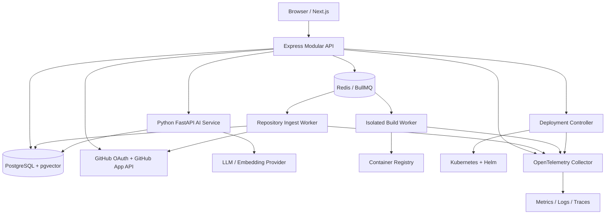

# DevPilot AI — Master Engineering Blueprint
**Version:** 1.0 | **Status:** Planned | **Approach:** System-design-first, incremental delivery

---

## 1. Product Vision
DevPilot AI is a multi-tenant developer platform that enables software engineers and platform teams to:
- Sign in with GitHub using OAuth with PKCE & server-side sessions.
- Grant access to select public or private repositories via GitHub App installations.
- Safely inspect repository topology, analyze code structures, extract API routes, and visualize dependency graphs.
- Query code using a grounded RAG assistant with precise file/line citations and workspace isolation.
- Generate deterministic infrastructure files (Dockerfiles, Docker Compose, Kubernetes manifests, Helm charts, GitHub Actions).
- Build, test, and scan container images inside disposable, isolated execution workers.
- Deploy approved releases with automated rollout verification, canary/blue-green support, and instant rollback.
- Monitor workloads, trace requests across distributed services, and stream real-time logs and metrics.

### Non-Goals for MVP
- Executing arbitrary, untrusted user code directly on the API host or main server.
- Supporting every esoteric programming language (MVP focuses on TypeScript/JavaScript and Python).
- Fully autonomous production deployments without explicit human review and approval gates.
- Writing custom replacements for Kubernetes, Helm, or GitHub Actions.
- Fragmenting into a dozen decoupled microservices before establishing domain boundaries.

---

## 2. User Roles & RBAC Matrix
| Role | Permissions |
|---|---|
| **Visitor** | Marketing pages, public docs, GitHub authentication initiation. |
| **Member** | View assigned projects, trigger repository re-analysis, query RAG assistant. |
| **Workspace Admin** | Manage members, manage GitHub App connections, approve production deployments, configure quotas. |
| **Workspace Viewer** | Read-only access to permitted projects, architecture graphs, and deployment status. |
| **Platform Operator** | Infrastructure management and observability; zero automated access to customer source code. |

*Rule:* Every API request is checked against the actor's workspace and project permissions. Never trust client-supplied owner IDs, GitHub installation IDs, or repository IDs.

---

## 3. High-Level Architecture



### Trust Boundaries
1. **Untrusted:** Web Browser / User Inputs, GitHub Source Code, Third-party dependencies, LLM output, Generated CI/CD workflows.
2. **Semi-Trusted:** Ingest Worker (executes static analysis strictly without executing code).
3. **Isolated Sandbox:** Build & Test Execution Workers (no Docker socket access, read-only root filesystems, bounded cgroups, strictly restricted egress).
4. **Trusted Core:** Express Modular Monolith API, PostgreSQL + pgvector, Redis, Python AI Service, Kubernetes Deployment Controller.

---

## 4. Architecture Decision Records (ADRs) Summary
- **ADR-001:** Modular monolith for core API (Node/Express/TypeScript) + separate Python AI service + isolated background workers.
- **ADR-002:** PostgreSQL as single source of truth (pgvector for embeddings); Redis for queues, caching, and distributed rate limiting.
- **ADR-003:** GitHub OAuth for identity; GitHub App installations for scoped repository authorization.
- **ADR-004:** Pin repository analysis and indexing strictly to immutable commit SHAs.
- **ADR-005:** Asynchronous HTTP `202 Accepted` + Job IDs for imports, indexing, builds, and rollouts.
- **ADR-006:** Deterministic templating combined with LLM suggestions; mandatory policy validation & human sign-off.
- **ADR-007:** Isolated ephemeral execution workers with gVisor/Kata or locked containers; never execute in the API host.
- **ADR-008:** Structured JSON logging, OpenTelemetry trace context propagation, and audit logging from Phase 0.
- **ADR-009:** Database-backed server-side sessions with cryptographic hashes and anti-CSRF defenses.
- **ADR-010:** Ephemeral raw source code retention; delete source clones post-analysis; retain only AST metadata and chunks.

---

## 5. Monorepo Structure
```text
devpilot-ai/
  apps/
    web/                         # Next.js App Router, Tailwind, React Flow
  services/
    api/                         # Modular Monolith Express API
      src/
        app.ts
        server.ts
        config/
        db/
        middleware/
        modules/
          auth/
          users/
          workspaces/
          github/
          projects/
          analysis/
          jobs/
          artifacts/
          deployments/
          audit/
        integrations/
    ai-service/                  # Python FastAPI service for RAG & LLM ops
      app/
        api/
        ingestion/
        retrieval/
        generation/
        evaluation/
    ingest-worker/               # Safe static code parser & AST worker
      src/
    build-worker/                # Isolated container build/scan worker
      src/
    deploy-controller/           # Helm & K8s rollout controller
      src/
  packages/
    contracts/                   # Shared TypeScript Zod schemas & types
    ui/                          # Shared UI components
    config/                      # Shared linting/tsconfig
    telemetry/                   # Shared OpenTelemetry helpers
  infrastructure/
    compose/                     # Local development Docker Compose
    docker/                      # Service Dockerfiles
    kubernetes/                  # K8s manifests
    helm/                        # Helm charts
    monitoring/                  # Prometheus, Grafana, Loki configurations
  docs/
    architecture/
    adr/
    api/
    security/
    phases/
    runbooks/
  tests/
    integration/
    e2e/
    fixtures/
    security/
  .github/workflows/
  .env.example
  pnpm-workspace.yaml
  README.md
  MASTER_PLAN.md
  AGENTS.md
```

---

## 6. Database Design & Tenancy
All multi-tenant queries enforce `workspace_id` filtering. PostgreSQL Row Level Security (RLS) acts as defense in depth.

### Core Tables
- `users`: ID, email, display_name, avatar_url, created_at, updated_at.
- `oauth_accounts`: ID, user_id, provider, provider_user_id (UNIQUE), access_token (encrypted), refresh_token (encrypted), expires_at.
- `sessions`: ID, user_id, token_hash (UNIQUE), ip_address, user_agent, expires_at, revoked_at.
- `workspaces`: ID, name, slug (UNIQUE), owner_id, created_at.
- `workspace_members`: ID, workspace_id, user_id, role (`ADMIN`, `MEMBER`, `VIEWER`), UNIQUE(workspace_id, user_id).
- `github_installations`: ID, installation_id (UNIQUE), account_id, account_type, status.
- `workspace_installations`: workspace_id, github_installation_id, PRIMARY KEY(workspace_id, github_installation_id).
- `projects`: ID, workspace_id, name, description, created_at.
- `repositories`: ID, project_id, github_repo_id, installation_id, full_name, default_branch, visibility.
- `repository_versions`: ID, repository_id, commit_sha, commit_message, author, analyzed_at.
- `analysis_runs`: ID, version_id, status (`QUEUED`, `FETCHING`, `SCANNING`, `PARSING`, `COMPLETED`, `FAILED`), error_code, started_at, finished_at.
- `files`: ID, version_id, path, language, size_bytes, content_hash.
- `api_routes`: ID, version_id, method, path, source_file, source_line, confidence (`HIGH`, `MEDIUM`, `LOW`).
- `graph_nodes`: ID, version_id, kind (`FILE`, `MODULE`, `ROUTE`, `SERVICE`), file_path, metadata_json.
- `graph_edges`: ID, version_id, source_node_id, target_node_id, kind (`IMPORTS`, `CALLS`, `EXPOSES`).
- `source_chunks`: ID, version_id, file_path, start_line, end_line, content, embedding (VECTOR(1536)).
- `ai_conversations`: ID, project_id, user_id, title, created_at.
- `ai_messages`: ID, conversation_id, role (`USER`, `ASSISTANT`, `SYSTEM`), content, citations_json.
- `generated_artifacts`: ID, project_id, version_id, type (`DOCKERFILE`, `KUBERNETES`, `HELM`, `WORKFLOW`), spec_json, rendered_content, status (`PROPOSED`, `VALIDATED`, `APPROVED`, `COMMITTED`).
- `jobs`: ID, workspace_id, type, status, idempotency_key (UNIQUE), payload_json, attempts, max_attempts, created_at.
- `builds`: ID, project_id, commit_sha, image_digest, status, logs_location.
- `deployments`: ID, project_id, environment (`DEV`, `STAGING`, `PROD`), image_digest, release_id, status, approved_by, approved_at.
- `audit_events`: ID, workspace_id, actor_id, action, resource_type, resource_id, metadata_json, created_at.

---

## 7. State Machines

### Repository Import & Analysis
```
[QUEUED] -> [FETCHING] -> [SCANNING] -> [PARSING] -> [COMPLETED]
     |           |             |            |
     +-----------+-------------+------------+-----> [FAILED] / [CANCELLED]
```

### Build & Security Scanning
```
[QUEUED] -> [PREPARING] -> [TESTING] -> [BUILDING] -> [SCANNING] -> [SUCCEEDED]
     |            |             |            |            |
     +------------+-------------+------------+------------+-----> [FAILED] / [CANCELLED]
```

### Deployment Orchestration
```
[PENDING_APPROVAL] -> [QUEUED] -> [DEPLOYING] -> [VERIFYING] -> [HEALTHY]
         |               |              |              |
         v               |              v              v
    [REJECTED]           +--------> [FAILED] ----> [ROLLED_BACK]
```

---

## 8. Development Phases & Acceptance Gates
- **Phase 0 — Foundation & Architecture**: Monorepo scaffolding, local Docker Compose (PostgreSQL, Redis), baseline migrations, shared contracts, health checks, structured logging, CI pipeline, testing harnesses.
- **Phase 1 — Authentication & GitHub Integration**: GitHub OAuth with PKCE, server sessions, GitHub App installations, webhook validation, repo listing/importing.
- **Phase 2 — Repository Intelligence**: Safe file discovery, AST parsing (TS/JS, Python), API route extraction, dependency graph generation, React Flow visualization.
- **Phase 3 — RAG Code Assistant**: AST-aware chunking, pgvector hybrid search, LLM integration, citation grounding, prompt-injection defense.
- **Phase 4 — Infrastructure Generator**: Deterministic deployment specs, Dockerfile, Helm, Kubernetes templates, validation engines, approval UI.
- **Phase 5 — CI/CD Automation**: GitHub Actions workflow synthesis, build queue orchestration, SAST, image scanning, registry integration.
- **Phase 6 — Deployment Orchestration**: Local/Cloud K8s deployment, Helm release manager, rollout health checks, automated rollback.
- **Phase 7 — Monitoring & Observability**: OpenTelemetry tracing, Prometheus metrics, Grafana dashboards, log correlation, alert hooks.
- **Phase 8 — Hardening & Resilience**: Multi-tenant isolation verification, sandboxing, network policy enforcement, rate limiting, disaster recovery.
- **Phase 9 — Production Readiness**: End-to-end integration tests, load tests, security audit, deployment runbooks, live showcase.
