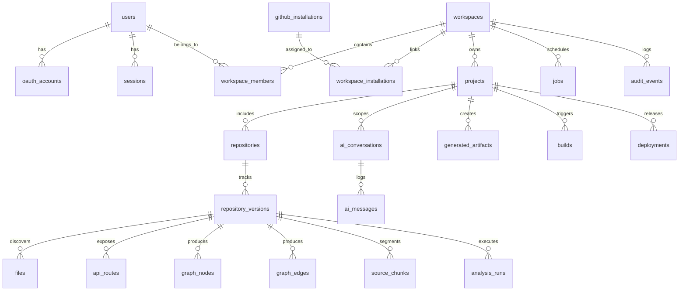

# Data Model & Tenancy Architecture

## 1. Entity Relationship Overview

## 2. Table Specifications & Constraints

### Identity & Access
- **`users`**
  - `id`: `UUID` (PK, default `gen_random_uuid()`)
  - `email`: `VARCHAR(255)` (Nullable, lowercased, indexed)
  - `display_name`: `VARCHAR(255)` (NOT NULL)
  - `avatar_url`: `TEXT`
  - `created_at`: `TIMESTAMPTZ` (NOT NULL, default `NOW()`)
  - `updated_at`: `TIMESTAMPTZ` (NOT NULL, default `NOW()`)

- **`oauth_accounts`**
  - `id`: `UUID` (PK)
  - `user_id`: `UUID` (FK -> `users.id` ON DELETE CASCADE)
  - `provider`: `VARCHAR(50)` (NOT NULL, e.g. `'github'`)
  - `provider_user_id`: `VARCHAR(255)` (NOT NULL)
  - `access_token_encrypted`: `TEXT` (NOT NULL)
  - `refresh_token_encrypted`: `TEXT`
  - `expires_at`: `TIMESTAMPTZ`
  - `UNIQUE(provider, provider_user_id)`

- **`sessions`**
  - `id`: `UUID` (PK)
  - `user_id`: `UUID` (FK -> `users.id` ON DELETE CASCADE)
  - `token_hash`: `VARCHAR(64)` (NOT NULL, UNIQUE, SHA-256 of cookie token)
  - `ip_address`: `INET`
  - `user_agent`: `TEXT`
  - `expires_at`: `TIMESTAMPTZ` (NOT NULL)
  - `revoked_at`: `TIMESTAMPTZ`

### Multi-Tenancy
- **`workspaces`**
  - `id`: `UUID` (PK)
  - `name`: `VARCHAR(100)` (NOT NULL)
  - `slug`: `VARCHAR(100)` (NOT NULL, UNIQUE)
  - `owner_id`: `UUID` (FK -> `users.id` ON DELETE RESTRICT)
  - `created_at`: `TIMESTAMPTZ` (NOT NULL)

- **`workspace_members`**
  - `id`: `UUID` (PK)
  - `workspace_id`: `UUID` (FK -> `workspaces.id` ON DELETE CASCADE)
  - `user_id`: `UUID` (FK -> `users.id` ON DELETE CASCADE)
  - `role`: `VARCHAR(50)` (NOT NULL: `'ADMIN'`, `'MEMBER'`, `'VIEWER'`)
  - `UNIQUE(workspace_id, user_id)`

### Projects & Repositories
- **`projects`**
  - `id`: `UUID` (PK)
  - `workspace_id`: `UUID` (FK -> `workspaces.id` ON DELETE CASCADE, Indexed)
  - `name`: `VARCHAR(100)` (NOT NULL)
  - `description`: `TEXT`
  - `created_at`: `TIMESTAMPTZ` (NOT NULL)

- **`repositories`**
  - `id`: `UUID` (PK)
  - `project_id`: `UUID` (FK -> `projects.id` ON DELETE CASCADE, Indexed)
  - `github_repo_id`: `BIGINT` (NOT NULL)
  - `installation_id`: `BIGINT`
  - `full_name`: `VARCHAR(255)` (NOT NULL, e.g. `'org/repo'`)
  - `default_branch`: `VARCHAR(100)` (NOT NULL, default `'main'`)
  - `visibility`: `VARCHAR(20)` (NOT NULL: `'PUBLIC'`, `'PRIVATE'`)

- **`repository_versions`**
  - `id`: `UUID` (PK)
  - `repository_id`: `UUID` (FK -> `repositories.id` ON DELETE CASCADE)
  - `commit_sha`: `VARCHAR(40)` (NOT NULL, Indexed)
  - `commit_message`: `TEXT`
  - `author`: `VARCHAR(255)`
  - `analyzed_at`: `TIMESTAMPTZ`
  - `UNIQUE(repository_id, commit_sha)`

### Code Intelligence & RAG
- **`files`**
  - `id`: `UUID` (PK)
  - `version_id`: `UUID` (FK -> `repository_versions.id` ON DELETE CASCADE, Indexed)
  - `path`: `TEXT` (NOT NULL)
  - `language`: `VARCHAR(50)`
  - `size_bytes`: `INTEGER` (NOT NULL)
  - `content_hash`: `VARCHAR(64)` (NOT NULL)

- **`api_routes`**
  - `id`: `UUID` (PK)
  - `version_id`: `UUID` (FK -> `repository_versions.id` ON DELETE CASCADE, Indexed)
  - `method`: `VARCHAR(10)` (NOT NULL)
  - `path`: `TEXT` (NOT NULL)
  - `source_file`: `TEXT` (NOT NULL)
  - `source_line`: `INTEGER` (NOT NULL)
  - `confidence`: `VARCHAR(20)` (NOT NULL: `'HIGH'`, `'MEDIUM'`, `'LOW'`)

- **`source_chunks`**
  - `id`: `UUID` (PK)
  - `version_id`: `UUID` (FK -> `repository_versions.id` ON DELETE CASCADE, Indexed)
  - `file_path`: `TEXT` (NOT NULL)
  - `start_line`: `INTEGER` (NOT NULL)
  - `end_line`: `INTEGER` (NOT NULL)
  - `content`: `TEXT` (NOT NULL)
  - `embedding`: `VECTOR(1536)` (Indexed via HNSW)
  - `tsv`: `TSVECTOR` (Indexed via GIN for hybrid search)

### Orchestration & Deployments
- **`jobs`**
  - `id`: `UUID` (PK)
  - `workspace_id`: `UUID` (FK -> `workspaces.id` ON DELETE CASCADE, Indexed)
  - `type`: `VARCHAR(50)` (NOT NULL: `'REPO_INGEST'`, `'BUILD'`, `'DEPLOY'`)
  - `status`: `VARCHAR(50)` (NOT NULL: `'QUEUED'`, `'PROCESSING'`, `'COMPLETED'`, `'FAILED'`, `'CANCELLED'`)
  - `idempotency_key`: `VARCHAR(255)` (UNIQUE)
  - `payload_json`: `JSONB` (NOT NULL)
  - `attempts`: `INTEGER` (DEFAULT 0)
  - `max_attempts`: `INTEGER` (DEFAULT 3)
  - `created_at`: `TIMESTAMPTZ` (DEFAULT NOW())

- **`deployments`**
  - `id`: `UUID` (PK)
  - `project_id`: `UUID` (FK -> `projects.id` ON DELETE CASCADE, Indexed)
  - `environment`: `VARCHAR(20)` (NOT NULL: `'DEV'`, `'STAGING'`, `'PROD'`)
  - `image_digest`: `VARCHAR(255)` (NOT NULL)
  - `release_id`: `VARCHAR(100)` (NOT NULL)
  - `status`: `VARCHAR(50)` (NOT NULL: `'PENDING_APPROVAL'`, `'QUEUED'`, `'DEPLOYING'`, `'VERIFYING'`, `'HEALTHY'`, `'FAILED'`, `'ROLLED_BACK'`)
  - `approved_by`: `UUID` (FK -> `users.id`)
  - `created_at`: `TIMESTAMPTZ` (DEFAULT NOW())
