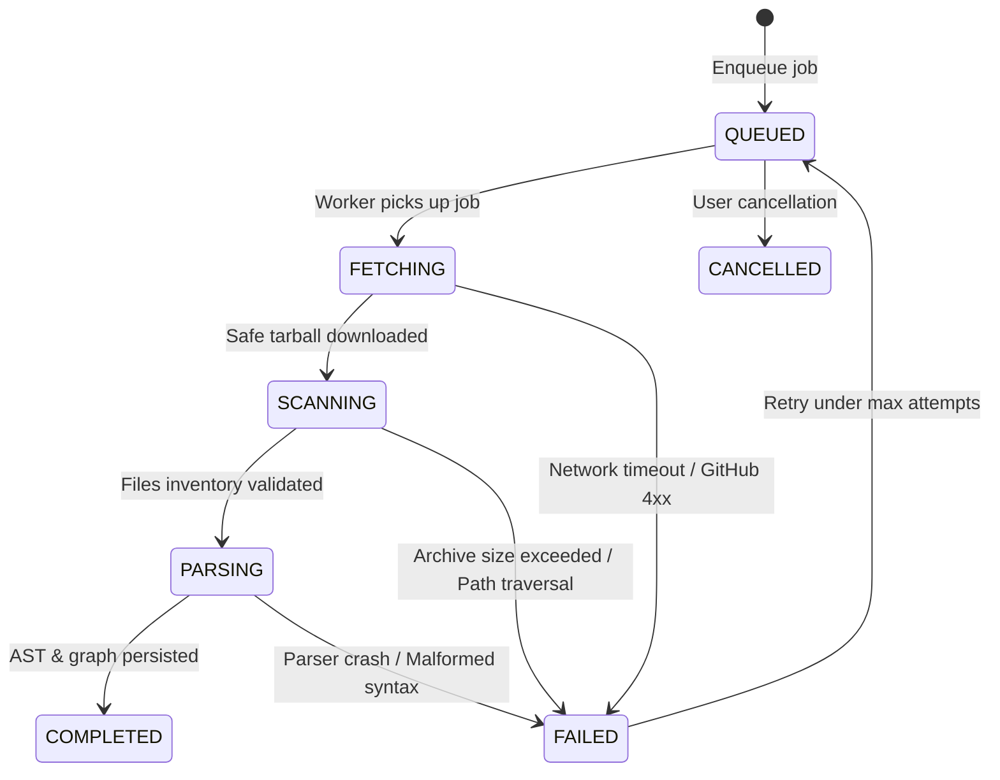
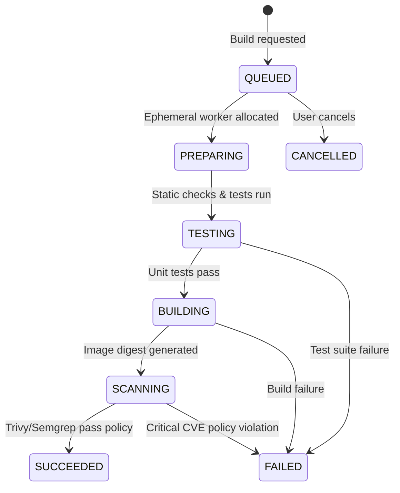
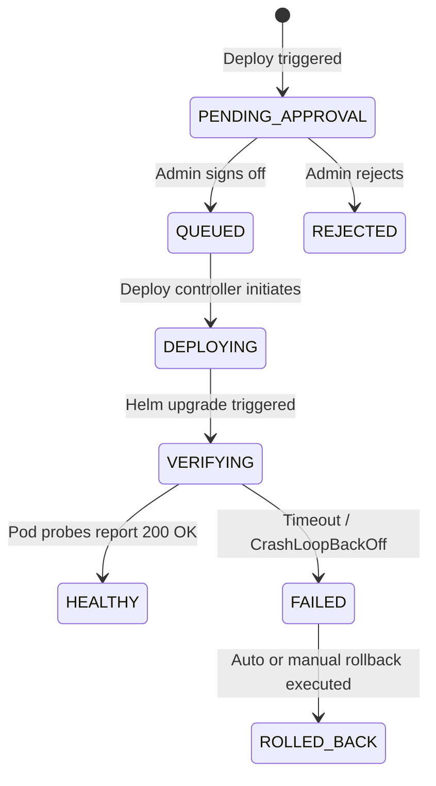

# State Machines & Distributed Retries

All long-running asynchronous workflows in DevPilot AI are governed by strict finite state machines. Invalid transitions fail fast and are rejected.

## 1. Repository Import & Ingest FSM

### Valid Transition Matrix
| Current State | Next Permitted States |
|---|---|
| `QUEUED` | `FETCHING`, `CANCELLED` |
| `FETCHING` | `SCANNING`, `FAILED`, `CANCELLED` |
| `SCANNING` | `PARSING`, `FAILED`, `CANCELLED` |
| `PARSING` | `COMPLETED`, `FAILED`, `CANCELLED` |
| `FAILED` | `QUEUED` (Manual or exponential backoff retry) |
| `COMPLETED` | Terminal state |
| `CANCELLED` | Terminal state |

---

## 2. Container Build & Security Scan FSM

---

## 3. Deployment Orchestration FSM

---

## 4. Idempotency & Retry Rules
1. **Idempotency Keys:** Every job dispatch generates an idempotency key derived from `workspace_id + action + target_resource_id + commit_sha`.
2. **Exponential Backoff:** Retried tasks utilize exponential jitter: $t_{wait} = \min(t_{max}, 2^{attempt} \times base + \text{jitter})$.
3. **Dead Letter Queue (DLQ):** After 3 failed attempts, jobs are marked `FAILED` with explicit `error_code` and dumped into the DLQ for operator inspection.
