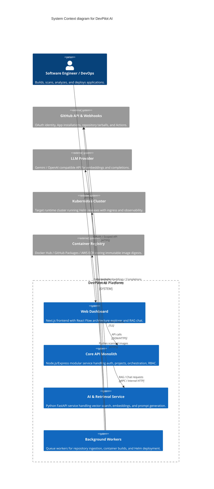

# System Context & Service Boundaries

## 1. System Context Diagram (C4 Level 1)

DevPilot AI connects developers and platform engineers to their source code repositories (via GitHub), LLM models, and cloud execution environments (Kubernetes clusters).

## 2. Component Boundaries (C4 Level 2)

### Monorepo Components & Responsibilities
- **`apps/web` (Next.js App Router):** Server-rendered pages, dashboard, responsive Tailwind UI, React Flow architecture graph visualizer, streaming RAG chat interface, deployment log viewer.
- **`services/api` (Express TypeScript Modular Monolith):**
  - `auth`: GitHub OAuth, session management, CSRF tokens.
  - `workspaces`: Multi-tenant workspace RBAC, member invitations, billing/quotas.
  - `github`: GitHub App installation sync, webhook signature verification.
  - `projects`: Project repository bindings, branch selection.
  - `analysis`: Code analysis coordination, route indexing, graph node storage.
  - `jobs`: BullMQ job dispatching, idempotency tracking, progress polling.
  - `artifacts`: Infrastructure specification builder, template rendering, approval gates.
  - `deployments`: Deployment target environments, Helm release orchestrator, rollback triggers.
  - `audit`: Immutable event audit logs.
- **`services/ai-service` (Python FastAPI):**
  - Chunker & embedding generator (text-embedding-3-small or Gemini embeddings).
  - Hybrid pgvector + full-text PostgreSQL retrieval query builder.
  - Context window budgeting and citation grounder.
  - Infrastructure prompt generator.
- **`services/ingest-worker` (Node.js Worker):**
  - Subscribes to BullMQ `repo-ingest` queue.
  - Securely unpacks repository tarball into memory/tmpfs.
  - Extracts TypeScript/JavaScript AST (via `@babel/parser` / `ts-morph`) and Python AST.
  - Identifies Express, Next.js, and FastAPI routes; generates dependency edges.
- **`services/build-worker` (Isolated Worker):**
  - Subscribes to BullMQ `build-pipeline` queue.
  - Executes container builds inside rootless BuildKit.
  - Runs Trivy vulnerability scans and Semgrep SAST checks.
  - Records immutable image digests (`sha256:...`).
- **`services/deploy-controller` (Kubernetes & Helm Worker):**
  - Subscribes to BullMQ `deployment` queue.
  - Connects to target Kubernetes namespace using least-privilege kubeconfig.
  - Executes `helm upgrade --install` with atomic rollout verification and timeout.
  - Emits health probe status and handles instant rollback on failure.
